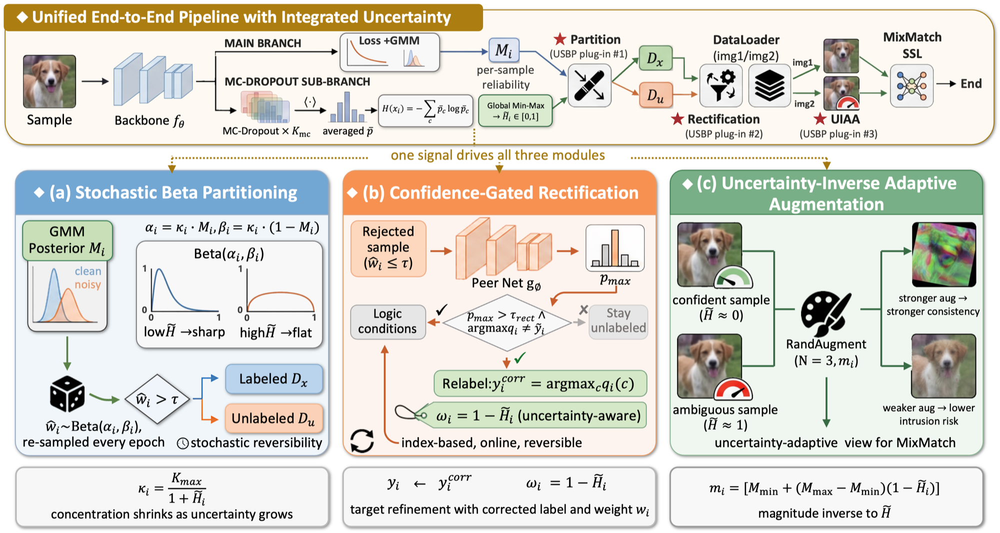

# USBP: Uncertainty-aware Stochastic Beta Partitioning

Official PyTorch implementation of

> **Decoupling Sample Selection from Biased Loss for Learning with Noisy Labels**
> Jiahao Qiu, Shu Chen, Jiacheng Yang, Junlong Gao, Yang Lu
> School of Informatics, Xiamen University
> *ICONIP 2026*

Selection-and-correction methods such as DivideMix split the training set by hard-thresholding a loss-based reliability score. Each epoch re-estimates that score from a loss the previous split has already biased, so mistakes reinforce themselves (*loss-feedback inertia*). USBP is a plug-and-play module that conditions the split on a loss-decoupled MC-Dropout uncertainty signal H̃. That one signal drives three operations, and none of them adds test-time cost:

1. **Stochastic Beta Partitioning.** Hard thresholding is replaced by sampling w_i ~ Beta(κ_i M_i, κ_i (1 − M_i)), where κ_i = κ_max / (1 + H̃_i). Ambiguous samples can cross the clean/noisy boundary across epochs.
2. **Confidence-Gated Cross-Network Rectification.** A sample is relabelled to the peer network's prediction when p_max > τ_rect and that prediction differs from the given label. The rectified sample gets weight ω_i = 1 − H̃_i.
3. **Uncertainty-Inverse Adaptive Augmentation.** The second view uses RandAugment (N = 3) with magnitude m_i = ⌊(1 − H̃_i) · M_max⌋.

<p align="center">
  
</p>

## Results

Test accuracy (%). Δ is the gain over the host method.

**CIFAR-10 / CIFAR-100, symmetric noise**

| Method | C10 20% | C10 50% | C10 80% | C10 90% | C100 20% | C100 50% | C100 80% | C100 90% |
|---|---|---|---|---|---|---|---|---|
| DivideMix | 96.1 | 94.6 | 93.2 | 76.0 | 77.3 | 74.6 | 60.2 | 31.5 |
| **DivideMix + USBP** | **96.6** | **95.0** | **94.0** | **91.4** | **78.9** | **77.2** | **68.5** | **44.2** |
| Δ | +0.5 | +0.4 | +0.8 | +15.4 | +1.6 | +2.6 | +8.3 | +12.7 |
| DPC | 96.1 | 95.2 | 93.5 | – | 79.4 | 76.5 | 63.0 | – |
| **DPC + USBP** | **96.4** | **95.5** | **94.2** | – | **80.5** | **77.7** | **65.6** | – |
| Δ | +0.3 | +0.3 | +0.7 | – | +1.1 | +1.2 | +2.6 | – |

**CIFAR-N (human-annotated noise)**

| Method | C10N Aggregate | C10N Random1 | C10N Worst | C100N Noisy |
|---|---|---|---|---|
| DivideMix | 95.01 | 95.16 | 92.56 | 71.13 |
| **DivideMix + USBP** | **95.4** | **96.2** | **94.3** | **72.1** |
| Δ | +0.4 | +1.1 | +1.8 | +1.0 |

**Clothing1M, (mini) WebVision and CIFAR-10 40% asymmetric noise**

| Method | CIFAR-10 asym 40% | Clothing1M | WebVision top-1 | WebVision top-5 | ILSVRC12 top-1 | ILSVRC12 top-5 |
|---|---|---|---|---|---|---|
| DivideMix | 93.4 | 74.38 | 77.32 | 91.64 | 75.20 | 90.84 |
| **DivideMix + USBP** | **94.0** | **74.84** | **79.92** | **93.36** | **75.80** | **93.08** |
| Δ | +0.6 | +0.46 | +2.60 | +1.72 | +0.60 | +2.24 |

See the paper for comparisons with other methods, the ablation study and the overhead analysis.

## Repository structure

```
dividemix_usbp/                  # USBP on the DivideMix host
├── cifar/
│   ├── Train_cifar.py           # CIFAR-10/100: symmetric, asymmetric, CIFAR-N
│   ├── Train_cifar_ablation.py  # module ablation (--enable_beta / --enable_rect / --enable_uiaa)
│   ├── dataloader_cifar.py
│   ├── PreResNet.py             # PreAct ResNet-18 with MC-Dropout
│   ├── download_cifar_n.sh      # CIFAR-10N / CIFAR-100N human labels
│   ├── benchmark_usbp.py        # time / memory benchmark: DivideMix + USBP
│   ├── benchmark_baseline.py    # time / memory benchmark: DivideMix
│   └── benchmark_analysis.py    # tables and figures from the two benchmark CSVs
├── clothing1m/
│   ├── Train_clothing1M.py      # ImageNet-pretrained ResNet-50
│   └── dataloader_clothing1M.py
└── webvision/
    ├── Train_webvision_parallel.py  # (mini) WebVision, InceptionResNetV2, two GPUs
    ├── dataloader_webvision.py
    └── InceptionResNetV2.py
dpc_usbp/                        # USBP on the DPC host
└── cifar/
    ├── Train_cifar.py
    ├── dataloader_cifar.py
    ├── PreResNet.py
    ├── loss.py                  # EDL loss (from DPC)
    └── Asymmetric_Noise.py      # (from DPC)
```

Each folder is self-contained: run its scripts from inside the folder. Logs are written to `./checkpoint/`.

## Installation

```bash
pip install -r requirements.txt
```

`torchvision>=0.11` is required for `transforms.RandAugment`. `torchnet` is needed only for WebVision, and `pandas`/`matplotlib` only for `benchmark_analysis.py`.

## Data preparation

| Dataset | `--data_path` points to |
|---|---|
| CIFAR-10 | the extracted `cifar-10-batches-py` folder (`data_batch_1…5`, `test_batch`) |
| CIFAR-100 | the extracted `cifar-100-python` folder (`train`, `test`) |
| CIFAR-N | the CIFAR folder above; run `bash download_cifar_n.sh` so that `cifar-n-labels/` sits next to it |
| Clothing1M | the image root with DivideMix's annotation files (`noisy_label_kv.txt`, …) |
| (mini) WebVision | the root with `info/`, `google/`, `val_images_256/` and `imagenet/val/` (DivideMix layout) |

Synthetic noisy labels are generated on the first run and cached as `<data_path>/<r>_<noise_mode>.json`, so the same noise is reused across runs. For CIFAR-N, pass `--data_path` without a trailing slash.

## Training

### DivideMix + USBP

```bash
cd dividemix_usbp/cifar

# CIFAR-10 / CIFAR-100, symmetric noise
python Train_cifar.py --dataset cifar10  --num_class 10  --data_path ./cifar-10  --noise_mode sym --r 0.9
python Train_cifar.py --dataset cifar100 --num_class 100 --data_path ./cifar-100 --noise_mode sym --r 0.9

# CIFAR-10, 40% asymmetric noise
python Train_cifar.py --dataset cifar10 --num_class 10 --data_path ./cifar-10 --noise_mode asym --r 0.4

# CIFAR-100N
python Train_cifar.py --dataset cifar100 --num_class 100 --data_path ./cifar-100 --noise_mode cifarn

# Ablation, e.g. Beta + Rect without UIAA
python Train_cifar_ablation.py --dataset cifar100 --num_class 100 --data_path ./cifar-100 \
    --noise_mode sym --r 0.9 --enable_beta --enable_rect
```

Set `--lambda_u` (default 25) for each noise setting following DivideMix.

```bash
cd dividemix_usbp/clothing1m
python Train_clothing1M.py --data_path ./clothing1M/images

cd dividemix_usbp/webvision
python Train_webvision_parallel.py --data_path ./webvision/ --gpuid1 0 --gpuid2 1
```

### DPC + USBP

```bash
cd dpc_usbp/cifar
python Train_cifar.py --dataset cifar100 --num_class 100 --data_path ./dataset/cifar-100 \
    --noise_mode sym --r 0.8 --lambda_u 150
```

Settings used for the reported DPC + USBP results:

| Dataset | Noise | `--lambda_u` | `--dropout_p` | `--K_max` |
|---|---|---|---|---|
| CIFAR-10 | 20% sym | 0 | 0.4 | 10 |
| CIFAR-10 | 50% sym | 25 | 0.6 | 10 |
| CIFAR-10 | 80% sym | 25 | 0.6 | 10 |
| CIFAR-100 | 20% sym | 25 | 0.4 | 5 |
| CIFAR-100 | 50% sym | 150 | 0.4 | 5 |
| CIFAR-100 | 80% sym | 150 | 0.6 | 5 |

### Overhead benchmark

```bash
cd dividemix_usbp/cifar
python benchmark_baseline.py --dataset cifar100 --num_class 100 --data_path ./cifar-100 --noise_mode sym --r 0.8
python benchmark_usbp.py     --dataset cifar100 --num_class 100 --data_path ./cifar-100 --noise_mode sym --r 0.8
python benchmark_analysis.py --baseline benchmark_baseline_cifar100_sym_0.8.csv \
                             --usbp benchmark_USBP_cifar100_sym_0.8.csv
```

## Main USBP hyperparameters

| Argument | CIFAR default | Meaning |
|---|---|---|
| `--K_mcdropout` | 10 | MC-Dropout forward passes used to estimate H |
| `--dropout_p` | 0.6 | dropout rate for MC-Dropout |
| `--K_max` | 5.0 | κ_max, the Beta concentration cap |
| `--p_threshold` | 0.5 | τ, threshold applied to the sampled w |
| `--relabel_threshold` | 0.9 | τ_rect, the rectification confidence gate |

On CIFAR, warm-up is 10 epochs for CIFAR-10 and 30 for CIFAR-100, and the UIAA magnitude is capped at M_max = 20. Dropout is disabled at test time, so inference cost matches the host. Clothing1M and WebVision settings are given by the default arguments of their scripts.

## Acknowledgements

This code is built on [DivideMix](https://github.com/LiJunnan1992/DivideMix) and [DPC](https://github.com/chenchenzong/DPC). CIFAR-N labels come from [UCSC-REAL/cifar-10-100n](https://github.com/UCSC-REAL/cifar-10-100n).

## License

This project is released under the [MIT License](LICENSE). It is built on DivideMix, whose MIT license notice is included in the LICENSE file.

## Citation

```bibtex
@inproceedings{qiu2026usbp,
  title     = {Decoupling Sample Selection from Biased Loss for Learning with Noisy Labels},
  author    = {Qiu, Jiahao and Chen, Shu and Yang, Jiacheng and Gao, Junlong and Lu, Yang},
  booktitle = {International Conference on Neural Information Processing (ICONIP)},
  year      = {2026}
}
```
